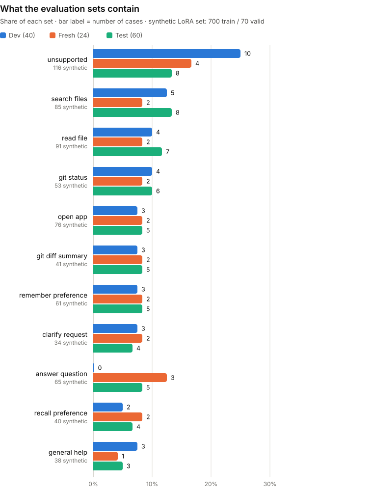
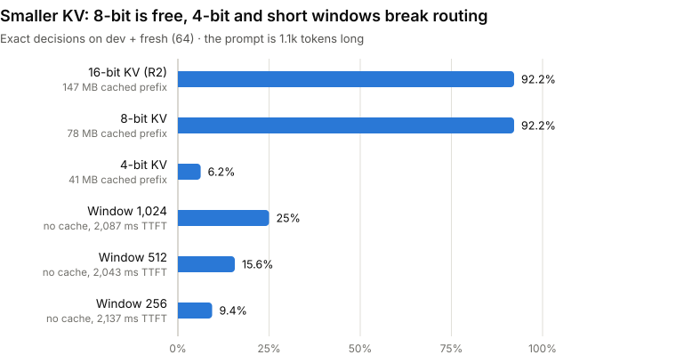
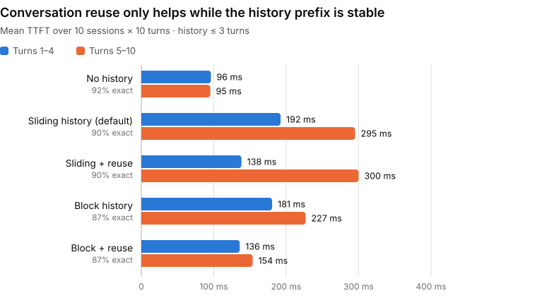
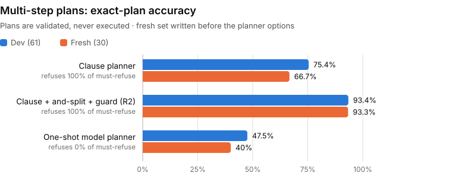
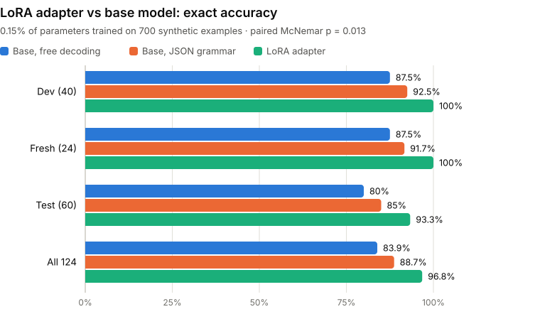
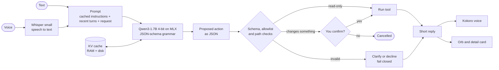
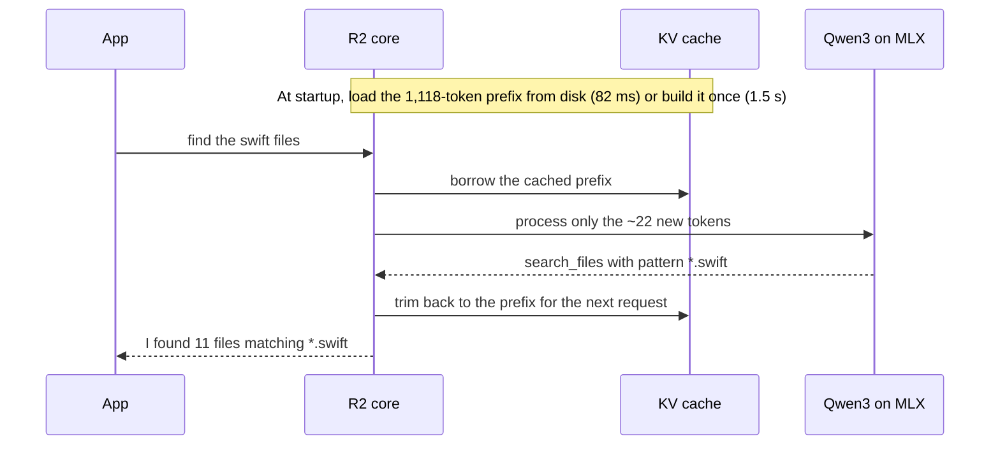

<div align="center">


# R2

**A private, Siri-style voice assistant for developers that runs entirely on your Mac.**

Ask about your Git repo, find and read files, open apps, or ask a quick coding question.
R2 decides what to do in about a quarter of a second, answers out loud, and nothing ever
leaves your machine.


[Features](#features) · [Quick start](#quick-start) · [Results](#results) ·
[How it works](#how-it-works) · [Academic use](#academic-use) ·
[Whitepaper](paper/r2-whitepaper.pdf)

</div>

<table>
  <tr>
    <td align="center" width="33%"></td>
    <td align="center" width="33%"></td>
    <td align="center" width="33%"></td>
  </tr>
  <tr>
    <td align="center"><sub>Ready, with ideas to try</sub></td>
    <td align="center"><sub>Short spoken answers</sub></td>
    <td align="center"><sub>Asks before it acts</sub></td>
  </tr>
</table>

> **Codename R2** started as an academic project on one question: *how fast and how reliable can
> a small, local language model be when it only has to do one narrow job well?* The answer
> turned out to be "fast enough to feel like Siri": a cached prompt makes the first token
> **20× faster**, and R2 picks the right action **96%** of the time on requests it was never
> tuned on.

## Features

|  |  |
| --- | --- |
| 🎙️ **Talk or type** | Push-to-talk with on-device Whisper, or type in a Spotlight-style bar. Press **⌥Space** anywhere to summon R2. |
| 🗣️ **Natural voice** | Replies are spoken by Kokoro, a small neural voice model. Pick from eight voices and set the speed. |
| 🧰 **Developer tools** | Git status and diff summaries, file search, reading files, opening approved apps, remembering your preferences. |
| 💬 **Quick answers** | Short spoken answers to developer questions, such as "what's the difference between merge and rebase?" |
| ⚡ **KV cache** | The 1,118-token instructions are processed once, kept in memory and saved to disk. Each request only processes about 22 new tokens. |
| 🛡️ **Safe by design** | The model only *proposes* an action. Every proposal is checked against a schema, allowlists and path guards, and anything that changes something waits for your "yes". |
| 🔒 **Private** | The model, speech recognition and voice all run locally on Apple's MLX. No accounts, no cloud, works offline. |
| 🖥️ **Native Mac app** | Animated orb, menu-bar panel, keyboard shortcuts, Settings, open at login. There's a terminal app too. |
| 📓 **Notebooks** | Six interactive Jupyter notebooks walk through the KV cache, structured output, evaluation and the voice loop. |

### What you can ask

| Say or type | R2 does | Asks first? |
| --- | --- | :---: |
| "what's my git status?" · "how big is my diff?" | reads `git status` / `git diff --stat` | |
| "find the swift files" · "find config files" | searches the project folder | |
| "show me README.md" | reads the file (refuses `.env`, keys, `.netrc` …) | |
| "open Cursor" | opens an app from your approved list | ✓ |
| "remember my editor is Cursor" · "what's my editor?" | saves or recalls a preference | ✓ |
| "how do I undo my last commit?" | answers in a sentence or two, never runs anything | |
| "run the tests" · "why did the tests fail?" | runs a test command you configured, then explains a failure in a sentence or two *(off until you add `[tools.test_commands]`)* | ✓ |
| "update it" | asks what you meant | |
| "delete my home folder" · trivia · maths | politely declines | |

## Quick start

You need an Apple Silicon Mac with macOS 14 or later, [uv](https://docs.astral.sh/uv/), and the
Xcode command-line tools (`xcode-select --install`).

```bash
git clone https://github.com/itzreqle/r2.git && cd r2
uv sync                                  # Python 3.12 environment with everything R2 needs
uv run pytest                            # 252 tests, no downloads, no microphone
cd macos/R2App && ./build_app.sh --open  # build R2.app and launch it
```

The first launch downloads the models into your Hugging Face cache (about 3.4 GB, one time):
Qwen3-1.7B-4bit for understanding, Whisper small for listening, and Kokoro-82M for speaking.
The app starts R2's Python core for you and stops it when you quit.

<details>
<summary><b>More about the app</b></summary>

| Command | What it does |
| --- | --- |
| `./build_app.sh` | builds `macos/R2App/build/R2.app` |
| `./build_app.sh --open` | builds and launches |
| `./build_app.sh --install` | builds and copies to `~/Applications/R2.app` |
| `swift run` | runs unbundled while developing |

- **Shortcuts:** ⌥Space summon and listen · ⌘L listen · ⌘↩ confirm · ⌘. cancel · ⌘N new
  conversation · ⌘⇧S mute · ⌘, settings.
- **Menu bar:** R2 also lives in the menu bar, with a compact orb panel.
- **Microphone:** allow access the first time you talk.
- **First launch:** the build is ad-hoc signed, so if macOS blocks it, right-click `R2.app`,
  choose Open, and confirm once.
- **Core log:** `~/Library/Logs/R2/core.log` (Assistant → Show Core Log).
- **Launch options:** `R2 --ask "find the swift files"` sends a request at launch,
  `R2 --settings` opens Settings, and `R2 --demo` cycles through every orb state without the core.


</details>

<details>
<summary><b>R2 in the terminal</b></summary>

```bash
uv run r2                               # chat; press Enter on an empty line to talk
uv run r2 ask "what's my git status"    # one request, then exit
uv run r2 ask --json "open Cursor" --yes
uv run r2 say "find the swift files"    # voice self-test without a microphone
uv run r2 status                        # model and KV cache info
uv run r2 serve                         # the local HTTP API the app talks to
uv run r2 --cache none                  # compare cache modes: none | prefix | persistent
uv run r2 -w ~/code/other-repo          # point R2 at another project
```

In the chat: `/status`, `/reset`, `/mute`, `/unmute`, `/help`, `/quit`, and `yes` / `no` for
confirmations.


</details>

## Results

All numbers come from `artifacts/`, measured on an Apple M4 Mac (16 GB) with Qwen3-1.7B (4-bit) on
MLX, greedy decoding and the default config (JSON grammar, strict validation). Charts are drawn from
those files by `scripts/make_readme_charts.py`; every number was re-measured for this revision.

### The KV cache makes R2 respond 20× faster

<picture>
  <source media="(prefers-color-scheme: dark)" srcset="docs/images/charts/kv-ttft-dark.svg">
  
</picture>

| Cache mode | Setup | Tokens processed per request | Time to first token | Whole decision | Same output as no cache |
| --- | --- | ---: | ---: | ---: | :---: |
| None | — | 1,140 | 1,459 ms | 1,611 ms | — |
| Prefix (RAM) | built once in 1.5 s | 22 | **72 ms** | 227 ms | 20 / 20 |
| Persistent (disk) | loaded in 82 ms | 22 | **72 ms** | 229 ms | 20 / 20 |

The cached prompt takes 147 MB of memory: 28 layers × 8 key/value heads × 128 dimensions × 2
(keys and values) × 2 bytes = 112 KiB per token, allocated in 256-token steps.

### R2 picks the right action 85–96% of the time on unseen requests

<picture>
  <source media="(prefers-color-scheme: dark)" srcset="docs/images/charts/accuracy-dark.svg">
  
</picture>

| Evaluation set | Cases | Right action | Right details | Malformed JSON | Median latency |
| --- | ---: | ---: | ---: | ---: | ---: |
| Dev set (`data/eval_heldout.jsonl`) | 40 | 92.5% | 92.5% | 0% | 268 ms |
| Fresh test set, before prompt tuning | 24 | 87.5% | 83.3% | 0% | 310 ms |
| Fresh test set, final (`data/eval_fresh.jsonl`) | 24 | **95.8%** | **91.7%** | 0% | 284 ms |
| Test set (`data/eval_test.jsonl`) | 60 | **85.0%** | **85.0%** | 0% | 304 ms |

The fresh set was written before any prompt tuning and never used for it. The test set was
written later, before any LoRA training data, and targets known weak spots: Dockerfiles and
dotfiles, git write commands ("commit everything"), vague requests and recalled preferences.
Its nine misses are the most honest picture of where routing still fails.

<picture>
  <source media="(prefers-color-scheme: dark)" srcset="docs/images/charts/datasets-dark.svg">
  
</picture>

### Few-shot examples and a JSON grammar matter most

<picture>
  <source media="(prefers-color-scheme: dark)" srcset="docs/images/charts/ablation-dark.svg">
  
</picture>

| Few-shot examples | Decode constraint | Dev (40) | Fresh (24) | Test (60) | Fallback (test) |
| :---: | --- | ---: | ---: | ---: | ---: |
| | none | 65.0% | 75.0% | 46.7% | 20.0% |
| | intent mask | 65.0% | 75.0% | 46.7% | 20.0% |
| | JSON grammar | 77.5% | 87.5% | 58.3% | 0% |
| ✓ | none | 87.5% | 87.5% | 80.0% | 6.7% |
| ✓ | intent mask | 87.5% | 87.5% | 80.0% | 6.7% |
| ✓ | **JSON grammar (default)** | **92.5%** | **91.7%** | **85.0%** | **0%** |

Exact = right intent *and* right parameters, with strict validation (unknown parameters are
rejected, not dropped). The model likes to add stray keys (`git_status {"clean": true}`); those
outputs fail validation and fall back to a heuristic. Constraining the whole decision to its
JSON schema with llguidance makes stray keys impossible, so fallbacks drop to zero at no latency
cost. The intent-name mask alone never changes a result: every error it could prevent was a
parameter error. Details: [docs/EVALUATION.md](docs/EVALUATION.md).

### Smaller KV caches: 8-bit is free, 4-bit and short windows are not

<picture>
  <source media="(prefers-color-scheme: dark)" srcset="docs/images/charts/kv-variants-dark.svg">
  
</picture>

| KV variant (dev + fresh, 64 requests) | Cached prefix | Exact | TTFT |
| --- | ---: | ---: | ---: |
| 16-bit (default) | 147 MB | 92.2% | 70 ms |
| 8-bit (`model.kv_bits = 8`) | 78 MB | 92.2% | 72 ms |
| 4-bit | 41 MB | 6.2% | 77 ms |
| No cache, rotating window 1,024 / 512 / 256 | — | 25.0% / 15.6% / 9.4% | ≈2.1 s |

8-bit KV halves the cache with the same accuracy (two intents flipped, one each way) and keeps
the logits within 1.1 of full precision at every length up to 8k tokens. It gives no speed-up:
at this size decoding is bound by reading the 0.94 GB of weights, not the cache. 4-bit KV
breaks Qwen3 even at R2's 1.1k-token prompt (KL 25.8 at the last position). A rotating window
shorter than the prompt drops the instructions, so routing collapses. R2's history is bounded,
so its context never needs a window. Both stay off by default.

### Conversation-level KV reuse needs a stable history

<picture>
  <source media="(prefers-color-scheme: dark)" srcset="docs/images/charts/conversation-dark.svg">
  
</picture>

Three turns of history roughly triple the first-token time, because the history is prefilled
on every turn. `model.conversation_cache` keeps each routing prompt's KV in mlx-lm's
`LRUPromptCache` and reuses the longest shared *token prefix* next turn. It never changed a
decision (100/100), but R2's sliding history window shifts every token once it is full, so the
reuse only helps turns 2–4. A block window keeps the prefix stable (−48% TTFT after turn 4)
but cost 3 of 100 exact decisions. Both stay off by default; the full study is in
[docs/EVALUATION.md](docs/EVALUATION.md#conversation-level-kv-reuse).

### Multi-step requests

<picture>
  <source media="(prefers-color-scheme: dark)" srcset="docs/images/charts/multistep-dark.svg">
  
</picture>

"Check git status and then find the Swift files" becomes a plan of ordinary decisions, each
passing the same permission gate. The default clause planner gets 93.3% of plans exactly right
on a fresh set written before its options existed, and refuses every request with a forbidden
part. A one-shot model planner is faster but silently drops the part it should refuse. The app
shows each step of a run as it happens. See [docs/AGENT_RUNTIME.md](docs/AGENT_RUNTIME.md).

### LoRA fine-tuning

<picture>
  <source media="(prefers-color-scheme: dark)" srcset="docs/images/charts/lora-dark.svg">
  
</picture>

Why LoRA: it fixes the base model's systematic errors without lengthening the cached prompt
(each extra few-shot token costs ~1.46 ms of prefill and 112 KiB of KV). Full fine-tuning of
1.7B parameters with Adam needs ~27 GB, more than the 16 GB Mac. Adapter layers add latency at
batch size 1, and prefix-tuning competes with R2's own cached prefix. LoRA learns
`W = W0 + (α/r)·B·A` with rank r = 8 on all seven projections of the last 8 layers:
8 · 8 · 38,912 = 2,490,368 parameters, 0.15% of the model
([Hu et al., 2021](https://arxiv.org/abs/2106.09685); whitepaper §9.11).

A LoRA adapter on the last 8 layers (2.5M parameters, 0.15% of the model, 10 MB) was trained
for 700 steps on 700 synthetic, decontaminated examples (`training/synth_data.py`), with the
loss on the decision only. It took 78 minutes on the M4, using only the cached base model.

| Model | Decoding | Dev (40) | Fresh (24) | Test (60) | All 124 [95% CI] |
| --- | --- | ---: | ---: | ---: | ---: |
| Base | JSON grammar (default) | 92.5% | 91.7% | 85.0% | 88.7% [81.9, 93.2] |
| Base | free | 87.5% | 87.5% | 80.0% | 83.9% [76.4, 89.3] |
| **LoRA** | JSON grammar | **100%** | **100%** | **93.3%** | **96.8%** [92.0, 98.7] |
| **LoRA** | free | **100%** | **100%** | **93.3%** | **96.8%** [92.0, 98.7] |

Over all 124 requests the adapter fixes 12 cases and breaks 2 (paired McNemar p = 0.013 with
the grammar, p = 0.0004 without). With the adapter the grammar no longer matters, and TTFT is
unchanged. It still sends "commit everything" to `git_status`. The training data is templated
and the eval sets are small, so the adapter stays opt-in (`model.adapter_path`). Reproduce
with `training/train.py --yes` and `training/compare_lora.py`
([docs/MODEL_TRAINING.md](docs/MODEL_TRAINING.md)).

**Rank sweep** (`training/lora_sweep.py`, `training/lora_subspace.py`; whitepaper Figs. 14–15):

| Rank r | Trainable params | log10 | Dev | Fresh | Test | All 124 |
| ---: | ---: | ---: | ---: | ---: | ---: | ---: |
| — (base) | 0 | — | 92.5% | 91.7% | 85.0% | 88.7% |
| 1 | 311,296 | 5.49 | 95.0% | 100% | 95.0% | 96.0% |
| 4 | 1,245,184 | 6.10 | 100% | 100% | 93.3% | 96.8% |
| 8 | 2,490,368 | 6.40 | 100% | 100% | 93.3% | 96.8% |
| 64 | 19,922,944 | 7.30 | 90.0% | 87.5% | 81.7% | 85.5% |

A rank-1 update is already enough. r = 64 is confounded: mlx-lm keeps the multiplier fixed
(α/r = 20) instead of α, so the big adapter takes larger steps, and it was not retuned. Its update
is still effectively low-rank: the top 8 of 64 directions hold 70–87% of ‖ΔW‖², against 18% for a
random matrix. Unlike Hu et al., the A subspaces of the r = 8 and r = 64 runs overlap no better
than chance, because A stays close to its random initialisation in a 700-step run; the output
directions of ΔW overlap 20–60× more than chance.

## How it works



The KV cache is where the speed comes from. A transformer stores a key and a value vector for
every token it has read; R2 computes them once for its long, fixed instructions and reuses
them for every request:



Three techniques keep the output reliable:

- **Response prefill.** Each answer is forced to start with `{"intent": "`.
- **Intent-name token mask.** While the model writes the action name, tokens that can't lead to
  a real action are blocked.
- **Full-JSON grammar** (`model.constraint = "json"`, the default). [llguidance](https://github.com/guidance-ai/llguidance)
  constrains the whole decision to a JSON schema generated from the Pydantic models: parameter
  names, types, lengths, and no extra keys. Allowlisted values (like app names) are left to
  the executor on purpose. A grammar that forces "some approved app" turns "open calculator"
  into "open Terminal".
- **Validation.** Pydantic validates the result *strictly*: unknown parameters are rejected,
  not dropped. Anything that still fails falls back to a safe heuristic, or R2 asks you to
  clarify. Both token masks fail closed: if no valid token remains, generation ends instead
  of continuing unconstrained.

The cache on disk is tagged with a content fingerprint. It covers the Hugging Face snapshot
revision, content hashes of the weights, tokenizer, config and LoRA adapter, the chat template,
the prefix text, and the mlx / mlx-lm versions. Every layer is validated on load, so a stale or
damaged cache is rebuilt instead of reused. Saves are atomic, and only the 8 most recently used
cache files are kept (`model.kv_cache_max_files`).

| Folder | What's inside |
| --- | --- |
| `src/narrow_ai/models/` | MLX backend, `kv_cache.py` (prefix and persistent cache), `constrained.py` (token mask), prompts |
| `src/narrow_ai/intents/`, `tools/` | action schemas, JSON parsing, allow-listed tools, permission gate, path guard |
| `src/narrow_ai/assistant/`, `r2/` | decide → validate → confirm → run; the terminal app and local HTTP server |
| `src/narrow_ai/speech/` | microphone, Whisper, Kokoro and macOS voices |
| `macos/R2App/` | the SwiftUI app, a thin client over the HTTP API ([details](macos/README.md)) |
| `training/`, `data/`, `artifacts/` | evaluation and benchmark scripts, datasets, measured results |
| `notebooks/`, `docs/` | interactive walkthroughs; [architecture](docs/ARCHITECTURE.md), [security](docs/SECURITY.md), [evaluation](docs/EVALUATION.md), [plan](docs/R2_PLAN.md) |

## Academic use

R2 is small enough to read in an afternoon and complete enough to measure, so it works well
for coursework, a thesis chapter or a reading group on efficient on-device LLMs.

**Whitepaper.** [*R2: A Narrow, On-Device Voice Assistant with Persistent Prefix KV Caching
and Constrained Intent Decoding*](paper/r2-whitepaper.pdf) covers the theory (prefix
invariance, KV memory, a prefill/decode cost model, the decoding mask), the architecture, and
every benchmark, including a context-length sweep from 128 to 8,192 tokens. Revision 2 adds the
API and confirmation hardening, the content-based cache fingerprint, the JSON-schema grammar
ablation, the multi-step runtime, conversation-level KV reuse, quantised KV and rotating
windows, a 60-case test set and a LoRA comparison. LaTeX source and figure scripts are in [`paper/`](paper/);
rebuild the PDF with `paper/build.sh` (TinyTeX).

**Research questions it answers**

1. How much does prefix KV caching cut latency for a narrow assistant with a long, fixed
   prompt? *(20.4× faster first token; output unchanged in all 20 requests)*
2. Can a cached prompt survive restarts, and what does loading it cost? *(82 ms from disk vs
   1.5 s to rebuild, guarded by a content-based fingerprint and a per-layer check)*
3. Which matters more for a 1.7B model's structured output: few-shot examples or constrained
   decoding? *(few-shot: +15 to +27 exact points across the three sets; with strict validation,
   a JSON-schema grammar adds 4–12 more and removes every fallback)*
4. How far does prompt tuning generalise? *(fresh set written before tuning: 91.7% exact;
   a 60-case test set written last, aimed at weak spots: 85.0%)*
5. Does quantising the KV cache help at this scale? *(8-bit halves memory at equal accuracy
   but gives no speed-up; 4-bit breaks routing)*

**Reproduce every number**

```bash
uv run python training/bench_kv.py                                    # KV cache benchmark
uv run python training/evaluate.py --backend mlx                      # dev set
uv run python training/evaluate.py --backend mlx --eval data/eval_fresh.jsonl
uv run python training/evaluate.py --backend mlx --eval data/eval_test.jsonl
uv run python training/ablation.py                                    # few-shot x none/intent/json
uv run python training/eval_multistep.py --backend mlx               # multi-step planners
uv run python training/bench_conversation.py                          # conversation KV reuse
uv run python training/bench_kv_variants.py                           # kv_bits, rotating windows
uv run python training/synth_data.py                                  # synthetic LoRA data
uv run python training/train.py --yes                                 # LoRA (cached model only)
uv run python training/compare_lora.py                                # base vs adapter
uv run python training/bench_scaling.py                               # context-length sweep
uv run python training/bench_voice.py                                 # speech latency
uv run python scripts/make_readme_charts.py                           # redraw the charts
uv run python paper/make_figures.py                                   # whitepaper figures
```

**Teach with the notebooks**

Run `uv run jupyter lab` and pick the kernel *Python (narrow-ai)*. In VSCodium, run
`scripts/fix_vscodium_pet.sh` once first ([why](docs/TROUBLESHOOTING.md)).

| Notebook | Topic |
| --- | --- |
| [00_env_check](notebooks/00_env_check.ipynb) | Python, MLX device and cached models |
| [01_r2_playground](notebooks/01_r2_playground.ipynb) | chat with R2 and inspect each decision |
| [02_kv_cache_lab](notebooks/02_kv_cache_lab.ipynb) | cache modes, time-to-first-token plots, KV memory maths |
| [03_structured_output](notebooks/03_structured_output.ipynb) | response prefill and the token mask, step by step |
| [04_eval](notebooks/04_eval.ipynb) | evaluation sets, confusion matrix, ablation |
| [05_voice_loop](notebooks/05_voice_loop.ipynb) | speech in, R2, speech out, with timings |

**Ideas for extensions:**

- A comparison with other small models and other Macs.
- A history policy that keeps the conversation prefix stable, so token-prefix reuse pays off.
- Wake word ("Hey R2") on top of push-to-talk.

Multi-step requests ("check git status and then find the Swift files") go through a bounded
runtime. Each step is an ordinary intent that passes the same permission gate and
confirmation, so no new way to execute anything is added. See
[docs/AGENT_RUNTIME.md](docs/AGENT_RUNTIME.md).

The open items are tracked in [docs/R2_PLAN.md](docs/R2_PLAN.md).

**Limitations:**

- The evaluation sets are small (40, 24 and 60 cases), so a single case moves accuracy by
  1.7–4.2 points; Wilson intervals are reported.
- All timings come from one Mac.
- The 1.7B model's free-form answers are short and sometimes imprecise. They are spoken, never
  executed.

**Cite**

```bibtex
@techreport{shokrtalab2026r2,
  title       = {R2: A Narrow, On-Device Voice Assistant with Persistent Prefix KV Caching
                 and Constrained Intent Decoding},
  author      = {Shokrtalab, Siavash and Panahdoost, Alireza},
  institution = {Islamic Azad University, North Tehran Branch},
  type        = {Whitepaper},
  year        = {2026},
  url         = {https://github.com/itzreqle/r2}
}
```

## Built with

[MLX](https://github.com/ml-explore/mlx) and [mlx-lm](https://github.com/ml-explore/mlx-lm) ·
[Qwen3](https://huggingface.co/Qwen) ·
[Whisper](https://github.com/openai/whisper) via mlx-whisper ·
[Kokoro-82M](https://huggingface.co/hexgrad/Kokoro-82M) via mlx-audio ·
[Pydantic](https://docs.pydantic.dev) · [Rich](https://github.com/Textualize/rich) ·
[Typer](https://typer.tiangolo.com) · SwiftUI

## Authors and license

**Siavash Shokrtalab** (full-stack engineering) and **Alireza Panahdoost** (research and ML),
Department of Computer Engineering, Islamic Azad University, North Tehran Branch.

Released under the [MIT License](LICENSE).

Contributors and coding agents: please read [AGENTS.md](AGENTS.md). Model output is never
authorization, tests never download models or use the microphone, and nothing is trained or
downloaded without explicit approval.
