<div align="center">

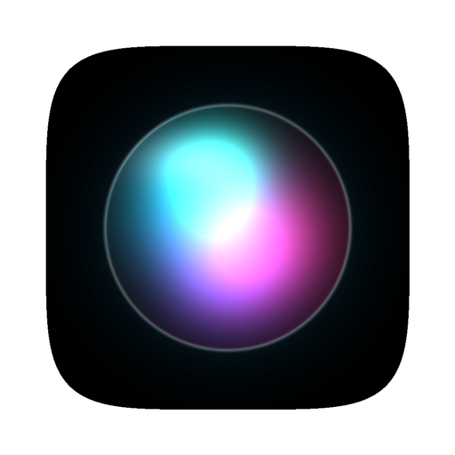

# R2

**A private, Siri-style voice assistant for developers that runs entirely on your Mac.**

Ask about your Git repo, find and read files, open apps, or ask a quick coding question.
R2 decides what to do in about a quarter of a second, answers out loud, and nothing ever
leaves your machine.


[Features](#features) · [Quick start](#quick-start) · [Results](#results) ·
[How it works](#how-it-works) · [Academic use](#academic-use) ·
[Whitepaper](paper/r2-whitepaper.pdf)

</div>

<table>
  <tr>
    <td align="center" width="33%">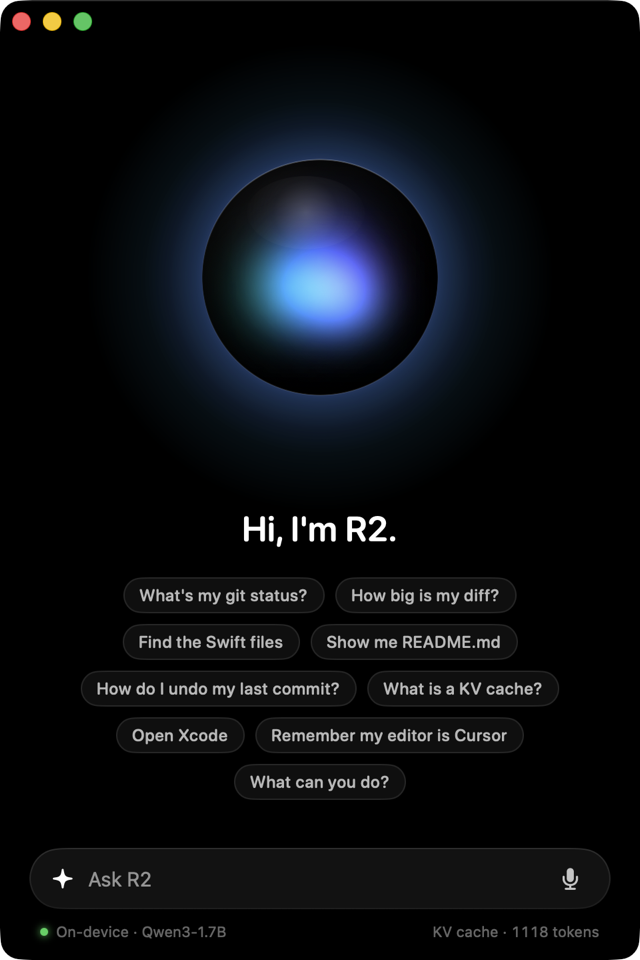</td>
    <td align="center" width="33%">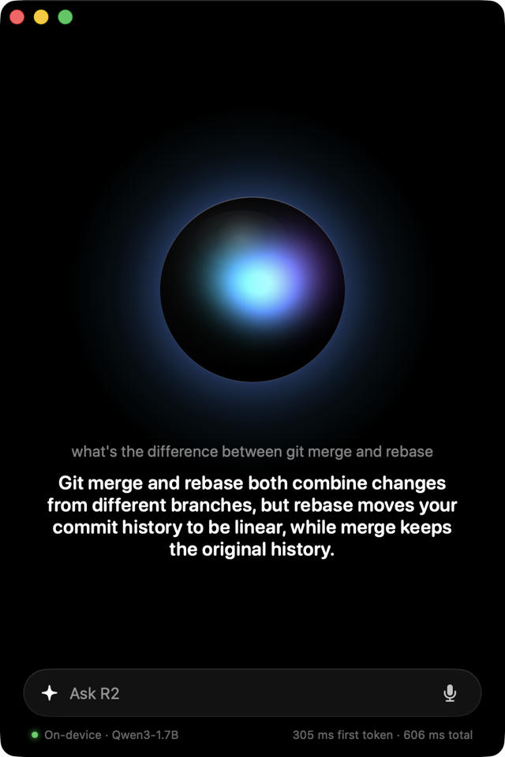</td>
    <td align="center" width="33%">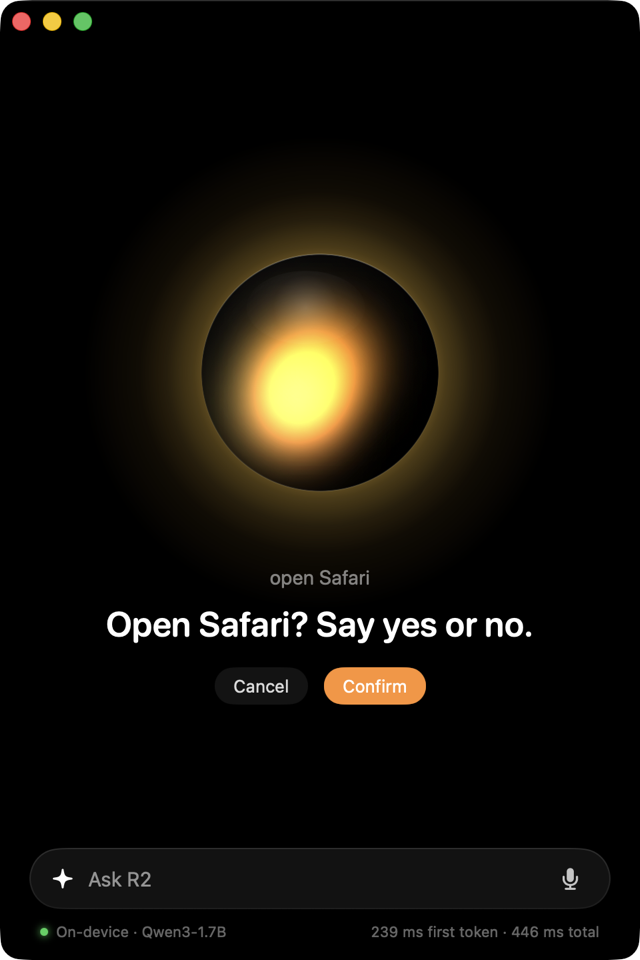</td>
  </tr>
  <tr>
    <td align="center"><sub>Ready, with ideas to try</sub></td>
    <td align="center"><sub>Short spoken answers</sub></td>
    <td align="center"><sub>Asks before it acts</sub></td>
  </tr>
</table>

> **Codename R2** started as an academic project on one question: *how fast and how reliable can
> a small, local language model be when it only has to do one narrow job well?* The answer
> turned out to be "fast enough to feel like Siri": a cached prompt makes the first token
> **20× faster**, and R2 picks the right action **96%** of the time on requests it was never
> tuned on.

## Features

|  |  |
| --- | --- |
| 🎙️ **Talk or type** | Push-to-talk with on-device Whisper, or type in a Spotlight-style bar. Press **⌥Space** anywhere to summon R2. |
| 🗣️ **Natural voice** | Replies are spoken by Kokoro, a small neural voice model. Pick from eight voices and set the speed. |
| 🧰 **Developer tools** | Git status and diff summaries, file search, reading files, opening approved apps, remembering your preferences. |
| 💬 **Quick answers** | Short spoken answers to developer questions, such as "what's the difference between merge and rebase?" |
| ⚡ **KV cache** | The 1,118-token instructions are processed once, kept in memory and saved to disk. Each request only processes about 22 new tokens. |
| 🛡️ **Safe by design** | The model only *proposes* an action. Every proposal is checked against a schema, allowlists and path guards, and anything that changes something waits for your "yes". |
| 🔒 **Private** | The model, speech recognition and voice all run locally on Apple's MLX. No accounts, no cloud, works offline. |
| 🖥️ **Native Mac app** | Animated orb, menu-bar panel, keyboard shortcuts, Settings, open at login. There's a terminal app too. |
| 📓 **Notebooks** | Six interactive Jupyter notebooks walk through the KV cache, structured output, evaluation and the voice loop. |

### What you can ask

| Say or type | R2 does | Asks first? |
| --- | --- | :---: |
| "what's my git status?" · "how big is my diff?" | reads `git status` / `git diff --stat` | |
| "find the swift files" · "find config files" | searches the project folder | |
| "show me README.md" | reads the file (refuses `.env`, keys, `.netrc` …) | |
| "open Cursor" | opens an app from your approved list | ✓ |
| "remember my editor is Cursor" · "what's my editor?" | saves or recalls a preference | ✓ |
| "how do I undo my last commit?" | answers in a sentence or two, never runs anything | |
| "update it" | asks what you meant | |
| "delete my home folder" · trivia · maths | politely declines | |

## Quick start

You need an Apple Silicon Mac with macOS 14 or later, [uv](https://docs.astral.sh/uv/), and the
Xcode command-line tools (`xcode-select --install`).

```bash
git clone https://github.com/itzreqle/r2.git && cd r2
uv sync                                  # Python 3.12 environment with everything R2 needs
uv run pytest                            # 42 tests, no downloads, no microphone
cd macos/R2App && ./build_app.sh --open  # build R2.app and launch it
```

The first launch downloads the models into your Hugging Face cache (about 3.4 GB, one time):
Qwen3-1.7B-4bit for understanding, Whisper small for listening, and Kokoro-82M for speaking.
The app starts R2's Python core for you and stops it when you quit.

<details>
<summary><b>More about the app</b></summary>

| Command | What it does |
| --- | --- |
| `./build_app.sh` | builds `macos/R2App/build/R2.app` |
| `./build_app.sh --open` | builds and launches |
| `./build_app.sh --install` | builds and copies to `~/Applications/R2.app` |
| `swift run` | runs unbundled while developing |

- **Shortcuts:** ⌥Space summon and listen · ⌘L listen · ⌘↩ confirm · ⌘. cancel · ⌘N new
  conversation · ⌘⇧S mute · ⌘, settings.
- **Menu bar:** R2 also lives in the menu bar, with a compact orb panel.
- **Microphone:** allow access the first time you talk.
- **First launch:** the build is ad-hoc signed, so if macOS blocks it, right-click `R2.app`,
  choose Open, and confirm once.
- **Core log:** `~/Library/Logs/R2/core.log` (Assistant → Show Core Log).
- **Launch options:** `R2 --ask "find the swift files"` sends a request at launch,
  `R2 --settings` opens Settings, and `R2 --demo` cycles through every orb state without the core.

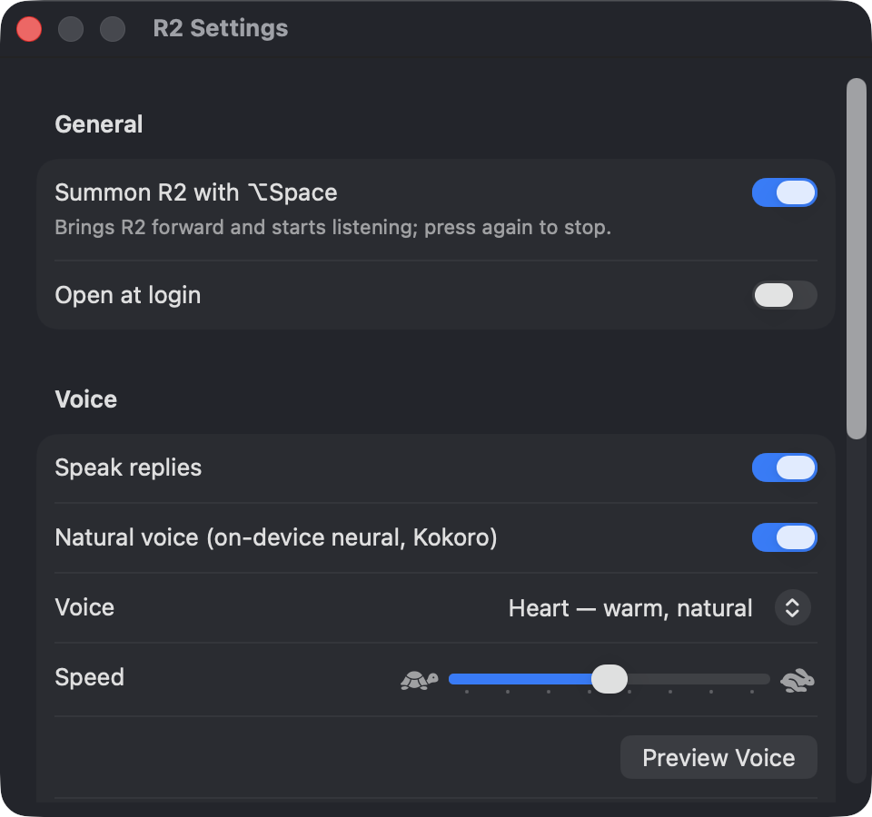

</details>

<details>
<summary><b>R2 in the terminal</b></summary>

```bash
uv run r2                               # chat; press Enter on an empty line to talk
uv run r2 ask "what's my git status"    # one request, then exit
uv run r2 ask --json "open Cursor" --yes
uv run r2 say "find the swift files"    # voice self-test without a microphone
uv run r2 status                        # model and KV cache info
uv run r2 serve                         # the local HTTP API the app talks to
uv run r2 --cache none                  # compare cache modes: none | prefix | persistent
uv run r2 -w ~/code/other-repo          # point R2 at another project
```

In the chat: `/status`, `/reset`, `/mute`, `/unmute`, `/help`, `/quit`, and `yes` / `no` for
confirmations.

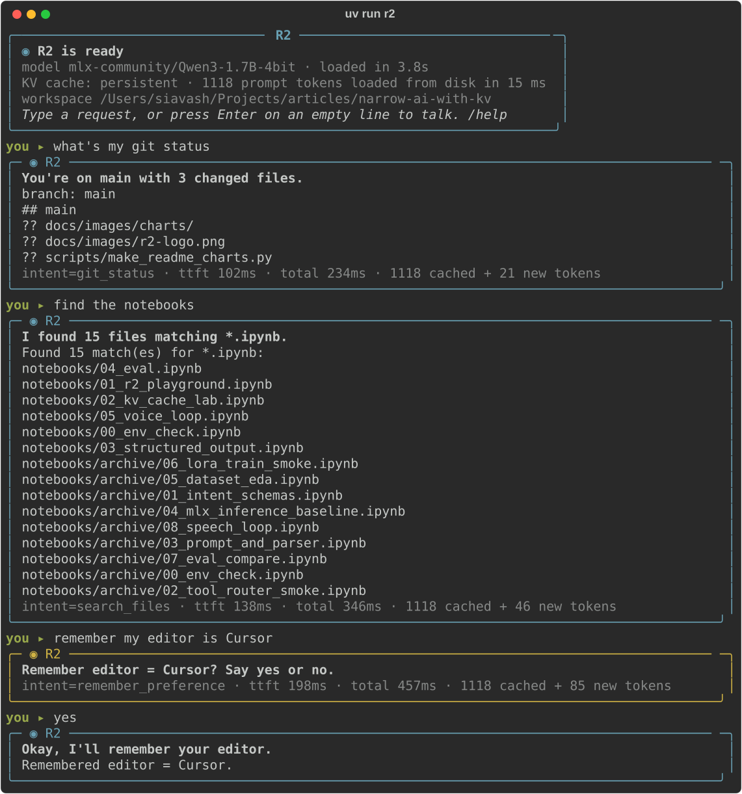

</details>

## Results

All numbers come from `artifacts/`, measured on an Apple Silicon Mac with Qwen3-1.7B (4-bit) on
MLX and greedy decoding. Charts are drawn from those files by `scripts/make_readme_charts.py`.

### The KV cache makes R2 respond 20× faster

<picture>
  <source media="(prefers-color-scheme: dark)" srcset="docs/images/charts/kv-ttft-dark.svg">
  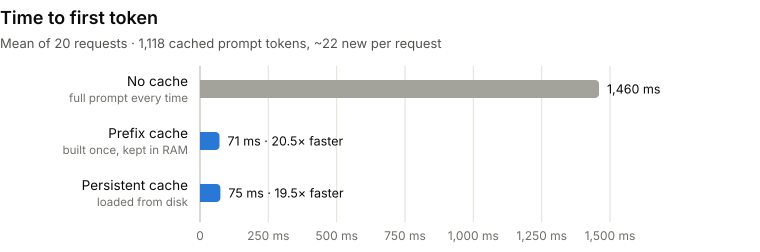
</picture>

| Cache mode | Setup | Tokens processed per request | Time to first token | Whole decision | Same output as no cache |
| --- | --- | ---: | ---: | ---: | :---: |
| None | — | 1,140 | 1,460 ms | 1,628 ms | — |
| Prefix (RAM) | built once in 1.5 s | 22 | **71 ms** | 227 ms | 20 / 20 |
| Persistent (disk) | loaded in 89 ms | 22 | **75 ms** | 227 ms | 20 / 20 |

The cached prompt takes 147 MB of memory: 28 layers × 8 key/value heads × 128 dimensions × 2
(keys and values) × 2 bytes = 112 KiB per token, allocated in 256-token steps.

### R2 picks the right action 96% of the time on unseen requests

<picture>
  <source media="(prefers-color-scheme: dark)" srcset="docs/images/charts/accuracy-dark.svg">
  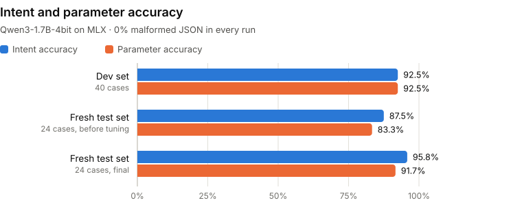
</picture>

| Evaluation set | Cases | Right action | Right details | Malformed JSON | Median latency |
| --- | ---: | ---: | ---: | ---: | ---: |
| Dev set (`data/eval_heldout.jsonl`) | 40 | 92.5% | 92.5% | 0% | 298 ms |
| Fresh test set, before prompt tuning | 24 | 87.5% | 83.3% | 0% | 310 ms |
| Fresh test set, final (`data/eval_fresh.jsonl`) | 24 | **95.8%** | **91.7%** | 0% | 311 ms |

The fresh test set was written *before* any prompt tuning and was never used for tuning, so it
measures how R2 handles requests it hasn't seen.

### Few-shot examples matter most

<picture>
  <source media="(prefers-color-scheme: dark)" srcset="docs/images/charts/ablation-dark.svg">
  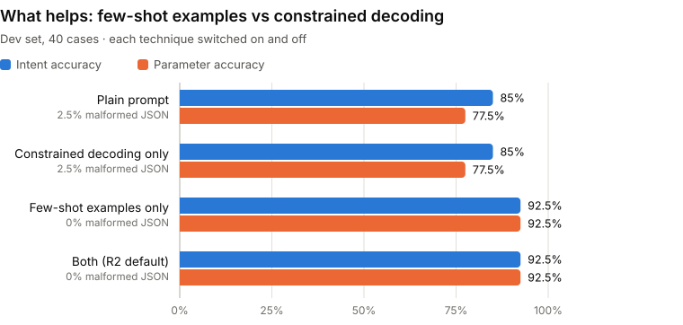
</picture>

| Few-shot examples | Constrained decoding | Right action | Right details | Malformed JSON |
| :---: | :---: | ---: | ---: | ---: |
| | | 85.0% | 77.5% | 2.5% |
| | ✓ | 85.0% | 77.5% | 2.5% |
| ✓ | | 92.5% | 92.5% | 0% |
| ✓ | ✓ | 92.5% | 92.5% | 0% |

Constrained decoding on its own doesn't change accuracy here. It only constrains the *intent
name*, and the one malformed output put a parameter in the wrong place. It stays on as a
guarantee: the model can never name an action that doesn't exist.

## How it works

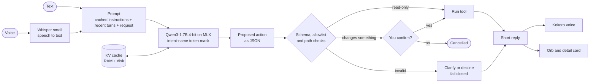

The KV cache is where the speed comes from. A transformer stores a key and a value vector for
every token it has read; R2 computes them once for its long, fixed instructions and reuses
them for every request:

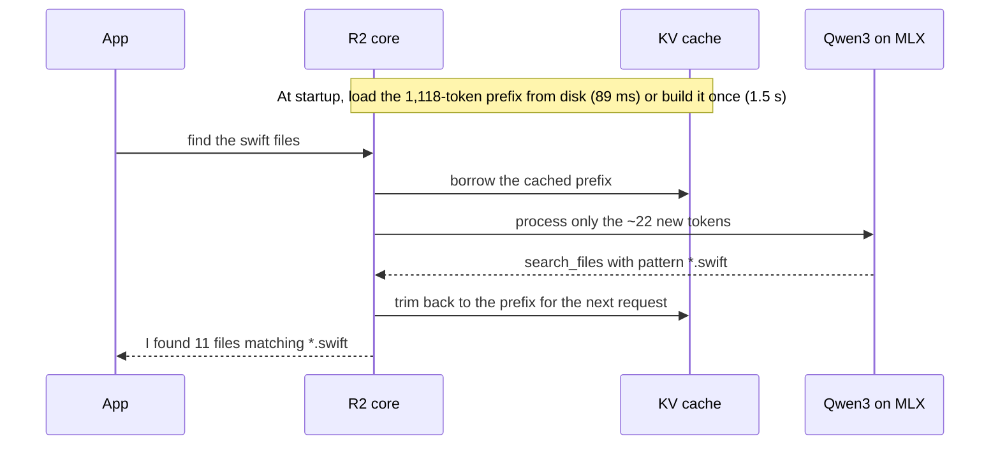

Three techniques keep the output reliable:

- **Response prefill.** Each answer is forced to start with `{"intent": "`.
- **Intent-name token mask.** While the model writes the action name, tokens that can't lead to
  a real action are blocked.
- **Validation.** Pydantic validates the result; anything that still fails falls back to a safe
  heuristic, or R2 asks you to clarify.

The cache on disk is tagged with a fingerprint (model, prompt template, prefix text, mlx-lm
version), so a stale cache is never reused.

| Folder | What's inside |
| --- | --- |
| `src/narrow_ai/models/` | MLX backend, `kv_cache.py` (prefix and persistent cache), `constrained.py` (token mask), prompts |
| `src/narrow_ai/intents/`, `tools/` | action schemas, JSON parsing, allow-listed tools, permission gate, path guard |
| `src/narrow_ai/assistant/`, `r2/` | decide → validate → confirm → run; the terminal app and local HTTP server |
| `src/narrow_ai/speech/` | microphone, Whisper, Kokoro and macOS voices |
| `macos/R2App/` | the SwiftUI app, a thin client over the HTTP API ([details](macos/README.md)) |
| `training/`, `data/`, `artifacts/` | evaluation and benchmark scripts, datasets, measured results |
| `notebooks/`, `docs/` | interactive walkthroughs; [architecture](docs/ARCHITECTURE.md), [security](docs/SECURITY.md), [evaluation](docs/EVALUATION.md), [plan](docs/R2_PLAN.md) |

## Academic use

R2 is small enough to read in an afternoon and complete enough to measure, so it works well
for coursework, a thesis chapter or a reading group on efficient on-device LLMs.

**Whitepaper.** [*R2: A Narrow, On-Device Voice Assistant with Persistent Prefix KV Caching
and Constrained Intent Decoding*](paper/r2-whitepaper.pdf) covers the theory (prefix
invariance, KV memory, a prefill/decode cost model, the decoding mask), the architecture, and
every benchmark, including a context-length sweep from 128 to 4,096 tokens. LaTeX source and
figure scripts are in [`paper/`](paper/).

**Research questions it answers**

1. How much does prefix KV caching cut latency for a narrow assistant with a long, fixed
   prompt? *(20.5× faster first token; output unchanged in all 20 requests)*
2. Can a cached prompt survive restarts, and what does loading it cost? *(89 ms from disk vs
   1.5 s to rebuild, guarded by a fingerprint)*
3. Which matters more for a 1.7B model's structured output: few-shot examples or constrained
   decoding? *(few-shot: +7.5 points on intent, +15 on parameters)*
4. How far does prompt tuning generalise? *(fresh test set written before tuning: 87.5% →
   95.8%)*

**Reproduce every number**

```bash
uv run python training/bench_kv.py                                    # KV cache benchmark
uv run python training/evaluate.py --backend mlx                      # dev set
uv run python training/evaluate.py --backend mlx --eval data/eval_fresh.jsonl
uv run python training/evaluate.py --backend mlx --no-few-shot --no-constrain   # ablation
uv run python training/bench_scaling.py                               # context-length sweep
uv run python training/bench_voice.py                                 # speech latency
uv run python scripts/make_readme_charts.py                           # redraw the charts
uv run python paper/make_figures.py                                   # whitepaper figures
```

**Teach with the notebooks**

Run `uv run jupyter lab` and pick the kernel *Python (narrow-ai)*. In VSCodium, run
`scripts/fix_vscodium_pet.sh` once first ([why](docs/TROUBLESHOOTING.md)).

| Notebook | Topic |
| --- | --- |
| [00_env_check](notebooks/00_env_check.ipynb) | Python, MLX device and cached models |
| [01_r2_playground](notebooks/01_r2_playground.ipynb) | chat with R2 and inspect each decision |
| [02_kv_cache_lab](notebooks/02_kv_cache_lab.ipynb) | cache modes, time-to-first-token plots, KV memory maths |
| [03_structured_output](notebooks/03_structured_output.ipynb) | response prefill and the token mask, step by step |
| [04_eval](notebooks/04_eval.ipynb) | evaluation sets, confusion matrix, ablation |
| [05_voice_loop](notebooks/05_voice_loop.ipynb) | speech in, R2, speech out, with timings |

**Ideas for extensions:**

- Multi-turn KV reuse across a whole conversation.
- 4- and 8-bit KV cache quantization.
- LoRA fine-tuning compared with few-shot prompting.
- A full JSON-schema grammar for parameters.
- A comparison with other small models.

The open items are tracked in [docs/R2_PLAN.md](docs/R2_PLAN.md).

**Limitations:**

- The evaluation sets are small (40 and 24 cases), so a single case moves accuracy by 2.5–4
  points.
- All timings come from one Mac.
- The 1.7B model's free-form answers are short and sometimes imprecise. They are spoken, never
  executed.

**Cite**

```bibtex
@techreport{shokrtalab2026r2,
  title       = {R2: A Narrow, On-Device Voice Assistant with Persistent Prefix KV Caching
                 and Constrained Intent Decoding},
  author      = {Shokrtalab, Siavash and Panahdoost, Alireza},
  institution = {Islamic Azad University, North Tehran Branch},
  type        = {Whitepaper},
  year        = {2026},
  url         = {https://github.com/itzreqle/r2}
}
```

## Built with

[MLX](https://github.com/ml-explore/mlx) and [mlx-lm](https://github.com/ml-explore/mlx-lm) ·
[Qwen3](https://huggingface.co/Qwen) ·
[Whisper](https://github.com/openai/whisper) via mlx-whisper ·
[Kokoro-82M](https://huggingface.co/hexgrad/Kokoro-82M) via mlx-audio ·
[Pydantic](https://docs.pydantic.dev) · [Rich](https://github.com/Textualize/rich) ·
[Typer](https://typer.tiangolo.com) · SwiftUI

## Authors and license

**Siavash Shokrtalab** (full-stack engineering) and **Alireza Panahdoost** (research and ML),
Department of Computer Engineering, Islamic Azad University, North Tehran Branch.

Released under the [MIT License](LICENSE).

Contributors and coding agents: please read [AGENTS.md](AGENTS.md). Model output is never
authorization, tests never download models or use the microphone, and nothing is trained or
downloaded without explicit approval.
